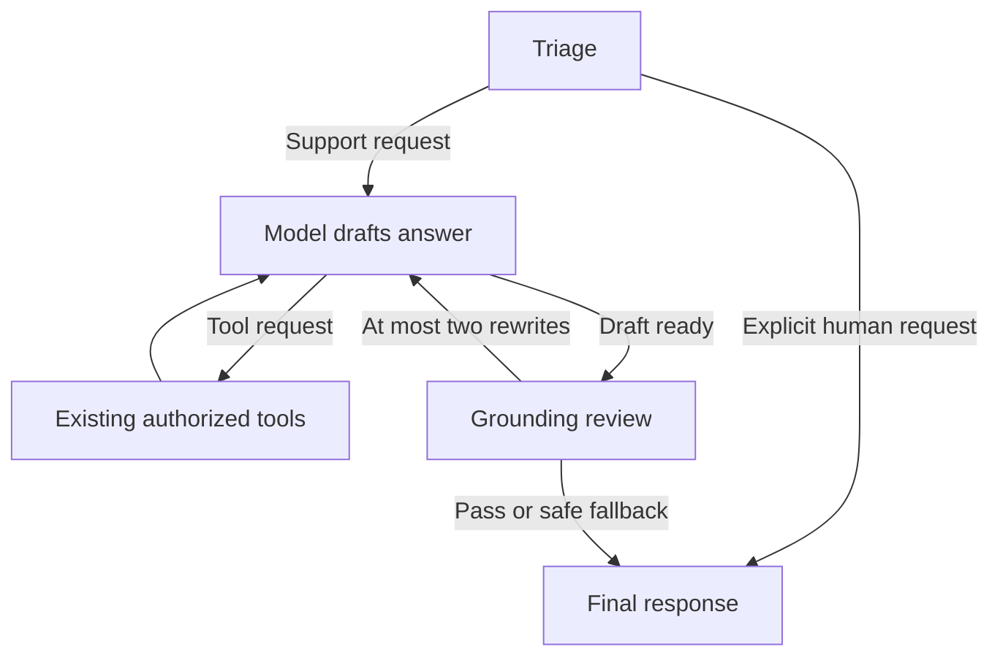

# HelpPilot adaptations

Sources and retained MIT notice are recorded in
[THIRD_PARTY_NOTICES.md](../THIRD_PARTY_NOTICES.md). Cross-encoder pair scoring
and sorting are adapted from HelpPilot's `rag.py`. Routing/review follows its
documented architecture but is implemented locally, not copied from `graph.py`.

## Support workflow



Triage uses the selected chat model to distinguish support from an explicit
human-contact request. It does not implement a human transfer queue; the final
message honestly asks the customer to contact staff. On routing errors, the
request proceeds to normal support. It does not infer refund eligibility.

The reviewer is a separate model invocation using only the current user turn,
returned tool evidence and the answer draft. It checks policy citations, order
facts, action claims, demo labels and approval/payment boundaries. Up to two
rewrites are allowed. Rewrite calls have no tools; fabricated tool requests on
rewrites are never executed. A failed or unavailable review ends with a safe
human-verification message. Prior successful tool writes are not rolled back;
the reply must not claim no operations took place.

The model, triage and reviewer carry LangGraph's `nostream` tag and the service's
`skip_stream` tag. Unreviewed prose is kept outside `messages`; only tool calls,
tool results and the final response enter the public history. Reviewed text is
delivered as a complete response rather than streamed before validation.

The same configured DeepSeek model handles all stages by default. This adds
triage/reviewer API calls and latency; it is not a cheaper-model routing setup.
DeepSeek's structured triage/reviewer calls disable thinking on a copied model,
because forced tool choice is incompatible with thinking mode. The solver's
configuration remains unchanged. See the official
[tool-choice documentation](https://api-docs.deepseek.com/api/create-chat-completion/).
Transport/schema review errors return the safe response immediately instead of
spending more solver calls on rewrites that cannot repair the review API.
Configure `ORDER_AGENT_TRIAGE_ENABLED=false` or `ORDER_AGENT_REVIEW_ENABLED=false`
to disable a stage explicitly. A model review is not an authorization boundary:
the existing backend ownership checks, staff approvals and simulation constraints
remain responsible for business authorization.

## Local Chinese reranking

The existing normalized BGE embeddings retrieve candidates from Chroma. With
reranking active, up to `POLICY_FETCH_K=8` candidates are fetched, the existing
cosine threshold is applied, and a local `BAAI/bge-reranker-base` CrossEncoder
scores query/passage pairs. The top `POLICY_TOP_K=3` retain filename/title/chunk
metadata. `score` remains cosine similarity; `rerank_score` is a separate model
score and is not compared with the cosine threshold or a refund probability.

Run the explicit first-time download on the host:

```powershell
uv run --extra local-rag python scripts/setup_policy_reranker.py
```

This downloads another model and uses local CPU resources, with no embedding API
key. The snapshot revision and a portable relative path are saved under
`data/reranker_models/model.json` only after successful inference. Runtime loads
that snapshot offline with remote code disabled. No weights are committed.

`POLICY_RERANK_MODE=auto` (default) enables reranking once the ready marker exists;
without it, retrieval explicitly reports `retrieval_mode=vector`. Use `on` to
require reranking (missing/invalid cache returns unavailable), or `off` to disable
it. Once enabled, reranker errors fail closed; they are not silently reported as
successful reranking. Restart after model setup because the RAG object is cached.

Compose now mounts the reranker cache read-only. Rebuild/recreate once to pick up
the code and mount:

```powershell
docker compose up -d --build --force-recreate agent_service streamlit_app
```

No database migration is required. The prior embedding index is still reusable.

## Validation and scope

```powershell
uv run --extra local-rag pytest tests/agents/test_support_review.py tests/agents/test_policy_reranker.py tests/agents/test_policy_rag.py tests/agents/test_policy_agent_verification.py tests/integration/test_customer_access.py -q
```

These are offline tests using fake model responses/scores and real local Chroma
where applicable. They check bounded retry, no repeated mutations, hidden drafts,
candidate selection, source preservation and existing ownership isolation. They
do not establish real model answer quality or reranking gains. Use the existing
`scripts/verify_policy_agent.py` for a separately authorized live policy-only run;
it sends project prompts/policy evidence to DeepSeek and uses account credits.

HelpPilot's evaluation scores and 30-case dataset are not imported or claimed.
Its SQLite pause/resume approval implementation is not substituted for the
existing authenticated PostgreSQL staff workflow.

A live, policy-only DeepSeek verification completed after adapting structured
calls for DeepSeek thinking/tool-choice compatibility. Observed diagnostics were
`triage_status=ok`, `route=solve`, `review_status=passed`, and one review attempt;
all nine answer/tool structural checks passed. Manual comparison confirmed that
the refund materials, seven-day qualification caveat, and approval/execution
distinction matched the displayed demo evidence. This run used vector retrieval:
the reranker download failed with an SSL connection error and its ready marker
was absent. No business tools were allowed by the verification guard. This is one
live use case, not an overall accuracy or reranking-quality measurement.

On 2026-10-22, the model setup subsequently completed on the Windows host for
revision `2cfc18c9415c912f9d8155881c133215df768a70`, including real CPU inference.
The user then confirmed successful policy retrieval in the Docker UI and
`retrieval_mode=vector_rerank`. Earlier container requests reported AttributeError
and KeyError; their root cause remains unconfirmed. Retrieval failures now record
server-side exception tracebacks while the customer-facing response still omits
internal details. The successful retry establishes operation, not a measured
quality improvement or proof that the intermittent errors cannot recur.
